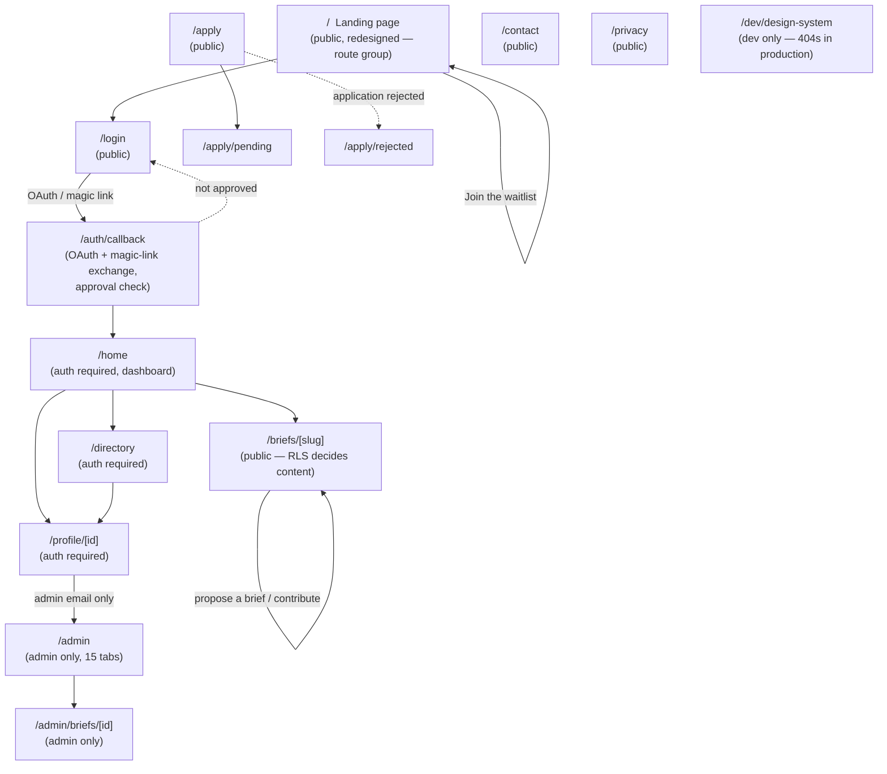
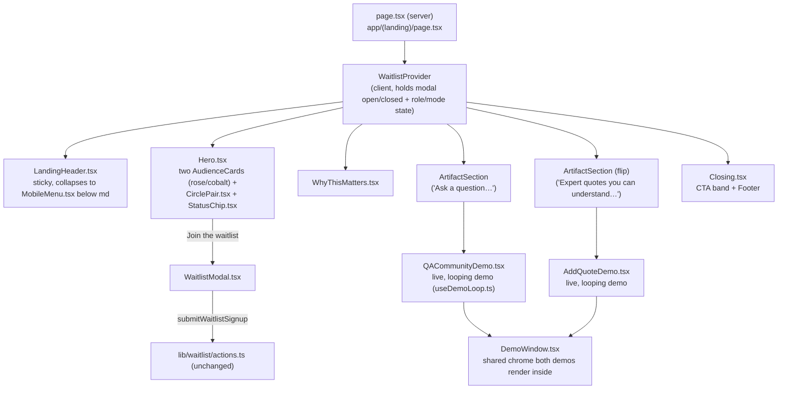

# Tell The World — Architecture Snapshot

**Date:** 2026-10-15
**Written after:** about 4 weeks of work landed on `master` since the
[2026-09-17](2026-09-17.md) snapshot. Two unrelated tracks ran in parallel:
(1) a full landing-page redesign in a new, documented design system (self-hosted
fonts, token-driven theme CSS, a dev-only component showcase, accessibility
passes on shared primitives) across roughly a dozen PRs, and (2) repo-hygiene
tooling — a migration-numbering CI gate, a secret scanner, env-var validation,
and a `bun run lint` sweep that cleared the entire `max-lines` decomposition
debt flagged in the last snapshot. No brief-feature, home-dashboard, or
database-schema work landed in this window. See [README.md](README.md) for
how this snapshot fits into the doc history, and the previous snapshot for
what the app looked like before this pass.

This is a structural reference for developers joining the project: how a
request flows through the app, how pages/components/data connect, and how
the pieces are supposed to talk to each other. It is not a tutorial — for
setup and day-to-day conventions see [`CONTRIBUTING.md`](../../CONTRIBUTING.md).

---

## 1. Tech stack

- **Next.js 16.1.6** (App Router), **React 19.2.3**, **TypeScript** (`strict: true`),
  **Tailwind CSS 4** (`@theme` CSS-token syntax, no JS config file)
- **Supabase**: Postgres + Auth (Google/LinkedIn OAuth + magic link, no
  passwords) + Row Level Security + Storage (4 buckets, unchanged since the
  last snapshot)
- **Resend** for transactional email
- **Lexical** for the brief Explainer/FAQ rich-text editor — unchanged
- **Fonts, now self-hosted.** `app/layout.tsx` used to pull EB Garamond and
  Inter from Google Fonts at build time; a Vercel deploy failed on
  2026-10-06 when that download failed. Both are now `next/font/local`
  variable `.woff2` files under `app/fonts/` (from the `@fontsource-variable`
  npm packages, SIL OFL-1.1 licensed), registered once on `<body>` in the
  root layout so every route shares them. IBM Plex Mono is still loaded via
  `next/font/google` (lower risk, only used for small UI labels).
- **Playwright** for end-to-end tests (E2E only — no unit test runner, still)
- **Bun** for package management/scripts (not npm/npx/node — see repo
  `CLAUDE.md`)
- Middleware lives in `proxy.ts` at the repo root — unchanged.
- No client-side state library anywhere in the repo — unchanged.
- **New: a migration-numbering CI gate.** `scripts/migrate.ts check` (wired
  into CI as `bun run migrate:check`) fails the build on any *new* duplicate
  `NNN_` migration prefix, and fails on a bad filename. See §9 for how it
  deliberately grandfathers in the two pre-existing duplicates this project
  already shipped.
- **New: `varlock` for env-var validation** (`.env.schema`, `bun install`
  triggers a check) — catches a missing/malformed env var at install time
  instead of a confusing runtime failure.
- **New: gitleaks in CI** — scans the full git history for committed secrets
  on every PR, in a job that needs no repo secrets of its own (safe on fork
  PRs).

**Scale, for orientation (re-measured from the code, not carried over):** 14
page routes (13 production + 1 dev-only, see §4) + 1 route handler, 127
non-page/layout `.tsx` files, 36 database tables (unchanged — no new
migrations landed this window), 63 numbered SQL migration files, 257 total
`.ts`/`.tsx` files, ~40,100 lines of `.ts`/`.tsx` (includes the 1,901-line
generated `database.types.ts`). **Note on the line-count figure:** the last
snapshot reported ~79,700 lines for a similarly-sized file count (103
non-page/layout files vs. 127 now) — that number could not be reproduced by
a plain `find … | wc -l` over the same file set today and looks too high by
roughly 2x; treat today's ~40,100 as the more trustworthy baseline for the
*next* snapshot's diff, not as evidence of a 2x shrink in the codebase.

---

## 2. System context

Unchanged from the last snapshot — no new external services, no change to
the three Supabase clients, no change to the re-hosted-image pattern for
scraped `og:image`s. See [2026-09-17.md §2](2026-09-17.md#2-system-context)
for the diagram; it still holds.

---

## 3. Request lifecycle — `proxy.ts`

Core two-branch gate (`getUser()` → public/protected/logged-in-at-`/login`)
is unchanged. `PUBLIC_ROUTES` is unchanged (`/`, `/login`, `/apply`,
`/apply/pending`, `/apply/rejected`, `/privacy`, `/contact`), plus the
existing `/auth/*` and `/briefs/*` prefix matches.

**One addition:** `isPublicRoute()` now also allows `/dev/design-system`,
but only outside production (`process.env.NODE_ENV !== 'production'`) — see
§4. The page itself also calls `notFound()` in production as a second,
independent gate, so this route can never actually render in a deployed
build even if the proxy check were ever removed.

---

## 4. Route map

| Route | Auth | Server component | Client view |
| --- | --- | --- | --- |
| `/` | public | `app/(landing)/page.tsx` (server — **moved into a route group**, see below) | `components/landing/*` (header, hero, two live demos are client) |
| `/login` | public | `app/login/page.tsx` | unchanged |
| `/apply` | public | `app/apply/page.tsx` | unchanged |
| `/apply/pending`, `/apply/rejected` | public | static pages | — |
| `/auth/callback` | public | `app/auth/callback/route.ts` | — |
| `/contact` | public | `app/contact/page.tsx` | unchanged |
| `/privacy` | public | `app/privacy/page.tsx` | unchanged |
| `/dev/design-system` **(new, dev-only)** | public in dev, 404 in prod | `app/dev/design-system/page.tsx` | `Showcase.tsx` — every shared `components/ui/*` primitive in every state, for review/migration reference |
| `/home` | required | `app/home/page.tsx` — still the one exception to the page→View split (unchanged, see build-plan Step 4) | unchanged |
| `/directory` | required | unchanged | unchanged |
| `/profile/[id]` | required | unchanged | unchanged |
| `/briefs/[slug]` | public, RLS-scoped | unchanged | unchanged |
| `/admin` | admin email only | unchanged | unchanged |
| `/admin/briefs/[id]` | admin email only | unchanged | unchanged |

**Route-shape change: `app/page.tsx` → `app/(landing)/page.tsx`.** The
landing page moved into a Next.js route group, `app/(landing)/`, which also
now holds `app/(landing)/layout.tsx` — a thin wrapper that scopes a
`.landing-root` class and `font-ui` for the landing page only (the shared
fonts themselves are still registered once in the root `app/layout.tsx`, not
re-loaded per route). This is purely a file-organization change — the URL is
still `/` — but it's the kind of thing that breaks a stale mental model of
"the landing page is `app/page.tsx`," which is exactly what triggered this
snapshot being written (see the staleness check that filed this Story).

**Known gap, unchanged from the last snapshot: still no `/briefs` list
route.** `app/briefs/[slug]/` exists; `app/briefs/page.tsx` does not. The
three dead links identified last snapshot (`BriefView.tsx`, `ProfileView.tsx`,
`app/home/page.tsx`) are unchanged — this item is still open as
`docs/design/architecture-cleanup/build-plan.md` Step 3, not started.

---

## 5. Page-by-page component trees

Only the Landing page changed structurally this window. Every other screen
(Home, Directory, Profile, Brief, Admin, Apply, Contact, Privacy, Login) is
**unchanged** from [2026-09-17.md §5](2026-09-17.md#5-page-by-page-component-trees)
— re-verified against the current file tree, not just carried forward.

### Landing page (`/`) — redesigned

This is a full redesign in the new design system (`docs/design/design-system/`),
not an iteration on the silent-launch page from the last snapshot. The
silent-launch "Opening soon" framing, the `TwoCirclesSection`/`ClosingSection`
pairing, and the `RevealOnScroll` scroll-trigger wrapper are all gone,
replaced by:

**What changed, concretely:**
- **Sections, in order:** header → hero (headline + two audience cards, each
  with its own pre-selected-role waitlist button) → "why this matters now" →
  two `ArtifactSection`s, each pairing a short claim with a live, looping
  product demo (`QACommunityDemo`, `AddQuoteDemo`) inside a shared
  `DemoWindow` chrome → closing CTA + footer. The earlier "Imagine /
  200,000" section from the silent-launch page is gone — called out in the
  current `page.tsx` comment as "an unsourced projection."
- **Live demos are new.** `AddQuoteDemo.tsx` and `QACommunityDemo.tsx`
  (plus the shared `useDemoLoop.ts` hook and `DemoWindow.tsx` chrome) render
  self-looping, scripted product mockups directly on the marketing page —
  not connected to real data, purely illustrative.
- **`WaitlistModal` is unchanged in behavior** (still `submitWaitlistSignup`,
  still the honeypot/rate-limit/validation pattern from the last snapshot) —
  only its trigger surface changed (now `AudienceCard`'s per-role button in
  `Hero.tsx`, via `WaitlistProvider`'s shared open/role state, instead of
  the old page-level "Join the waitlist" / "Become an early tester" pair).
- **`components/landing/LegacyLandingPage.tsx` still exists, still unrouted**
  — kept for reuse, same as the last snapshot, now a third landing-page
  generation sitting dormant in the tree (silent-launch was itself a
  replacement for this one).
- **Accessibility pass (PR #127, "Landing finish").** Touch targets, 320px
  reflow, and modal a11y fixes landed across `Hero.tsx`, `LandingHeader.tsx`,
  `WaitlistButton.tsx`, `EarlyTesterLink.tsx`, and the shared
  `components/ui/Modal.tsx` — see §10.

---

## 6. Data access layer

Same core convention as the last snapshot (pages/actions call into
`lib/data/*.ts` + `lib/directory/queries.ts`, client passed in by the
caller). No new data-layer files landed this window — see §7 for the one
structural change (actions files split into directories).

---

## 7. Server actions map

Same `'use server'` convention as the last snapshot. **Structural change:**
the two largest actions files flagged as `max-lines` debt in the last
snapshot were split into directories (PR #105, done before this snapshot's
window opened but not yet reflected in `docs/architecture/`):

| File (last snapshot) | Now | Split by |
| --- | --- | --- |
| `lib/admin/actions.ts` (801 lines, 43 exports) | `lib/admin/actions/` — `applications.ts`, `brief-proposals.ts`, `content-queues.ts`, `coverage.ts`, `ctas.ts`, `misc-lists.ts`, `quotes.ts`, `shared.ts`, `index.ts` (re-exports) | Moderation domain |
| `lib/briefs/actions.ts` (638 lines, 21 exports) | `lib/briefs/actions/` — `coverage.ts`, `faq-and-ctas.ts`, `proposals-and-feedback.ts`, `qa.ts`, `quotes.ts`, `reviews.ts`, `index.ts` (re-exports) | Feature domain |

Both `index.ts` files re-export everything, so **no call-site import changed**
— `import { approveApplication } from '@/lib/admin/actions'` still resolves.
`requireAdmin()`-first is preserved in every split file (spot-checked, not
regressed). All other actions files (`lib/auth/actions.ts`,
`app/profile/[id]/actions.ts`, `lib/posts/actions.ts`,
`lib/messages/actions.ts`, `lib/contact/actions.ts`,
`lib/applications/actions.ts`, `lib/waitlist/actions.ts`,
`lib/briefs/explainer-engagement-actions.ts`,
`lib/admin/brief-actions.ts`, `lib/admin/explainer-actions.ts`) are
unchanged from the last snapshot.

### Admin approve-application flow

Unchanged from the last snapshot.

---

## 8. Security model

All nine points from the last snapshot still hold (`requireAdmin()` first,
`'use server'`/`server-only` separation, RLS-decides-visibility, search
sanitization, three independent rate limiters, OAuth approval gate,
clarity-check content gate, SSRF guard, `analytics_events` default-deny). No
regressions found. Three **new, infra-level safeguards** landed this window,
layered on top rather than replacing anything:

1. **Gitleaks secret scan in CI** (PR #115) — scans full git history on
   every PR, pinned version + checksum-verified binary rather than a
   third-party GitHub Action, runs with no repo secrets so it's safe on
   fork PRs.
2. **`varlock` env-var validation** (PR #113) — `.env.schema` checked at
   `bun install` time, catching a missing/malformed env var before it
   becomes a confusing runtime error.
3. **Migration-numbering CI gate** (PR #125, `bun run migrate:check`) — see
   §9 for what it does and does not catch.

---

## 9. Database schema

**No schema change this window** — still 36 tables, still 63 numbered
migration files, highest is still `061_seed_default_source_organizations.sql`.
Everything in [2026-09-17.md §9](2026-09-17.md#9-database-schema) (the ER
diagram, full table list, enum changes, storage buckets, RLS fix history)
is unchanged and still accurate.

**Migration numbering collisions — status changed, but not by being fixed.**
The last snapshot flagged two unresolved filename collisions (`038_*` ×2,
`043_*` ×2) and `docs/design/architecture-cleanup/build-plan.md` Step 1
proposed renumbering the later-landed file in each pair (to `062`/`063`).
**That renumbering has not happened** — `supabase/038_brief_timeline_events.sql`
and `supabase/038_content_posts_moderation_and_likes.sql` are still both
present, same for the `043_*` pair.

Instead, PR #125 added `scripts/migrate.ts check` (the new
`migrate:check` CI step, §1/§8) with a `LEGACY_DUPLICATES` map that
**explicitly allows exactly these two prefixes to have two files each**, and
fails CI if a *third* file ever reuses `038` or `043`, or if any *new*
duplicate prefix appears. In effect, the project has quietly decided not to
renumber these two historical collisions and instead codified them as a
permanent, CI-enforced exception — a different resolution than the build
plan originally proposed. `docs/design/architecture-cleanup/build-plan.md`
Step 1 is updated alongside this snapshot to reflect that (see the diff on
this PR).

Generated types regeneration command is unchanged.

---

## 10. Shared UI primitives

Grew meaningfully this window as part of the design-system work, though the
underlying component *conventions* (presentational, `cn()`-composed
Tailwind classes, no new state library) are unchanged.

| Area | What's new |
| --- | --- |
| `components/ui/` | New since the last snapshot: `Button.tsx`, `Checkbox.tsx`, `ChoiceChips.tsx`, `ConfirmDialog.tsx`, `EmptyState.tsx`, `Field.tsx`, `FormSection.tsx`, `LockedPanel.tsx`, `Menu.tsx`, `Skeleton.tsx`, `Tag.tsx`, `Toast.tsx`, `icons.tsx` — a materially larger shared-primitive set than the last snapshot's `Avatar`/`RoleBadge`/`Pagination`/`Carousel` core. |
| `ToastProvider` | **New, wired at the root.** `app/layout.tsx` now wraps the whole app in `<ToastProvider>` (`components/ui/Toast.tsx`) — a sitewide toast/notification affordance that didn't exist in the last snapshot. Not yet widely consumed outside the design-system showcase as of this snapshot — worth checking call sites before assuming it's in active use everywhere. |
| `Modal.tsx` a11y | PR #127 hardened the shared modal: labelled dialog role, focuses the title on open, makes `#app-root` `inert` while open (verified in `tests/design-system.spec.ts`), Escape returns focus to the trigger. This is the same `Modal` every existing modal in the app already uses, so the fix applies sitewide, not just to the landing page. |
| `app/dev/design-system/` **(new)** | `page.tsx` + `Showcase.tsx` — a dev-only (404s in production) reference page rendering every shared primitive in every state, for design review and as a migration-tracking aid. Exercised directly by `tests/design-system.spec.ts`. |
| Theme CSS | `app/app-theme.css` (new) carries the design-system's CSS custom properties (colors, type scale, spacing tokens from `DESIGN.md`); `app/landing-theme.css` scopes landing-only base styles under `.landing-root`; `app/globals.css` remains the pre-existing, unmigrated-screens stylesheet. Three stylesheets now coexist deliberately — `app/layout.tsx`'s own comment states unmigrated screens must keep looking as they do today, and each migrated page opts in with `bg-parchment text-umber font-ui`. |
| Fonts | See §1 — self-hosted via `next/font/local`, not Google Fonts. |

`components/landing/` additions beyond what's listed in §5:
`WaitlistProvider.tsx` (shared open/role state consumed by `Hero`,
`LandingHeader`, `WaitlistModal`), `MobileMenu.tsx`, `StatusChip.tsx`,
`EarlyTesterLink.tsx`, `CirclePair.tsx`, `ArtifactSection.tsx`,
`DemoWindow.tsx`, `useDemoLoop.ts`.

---

## 11. Testing

Playwright specs grew from 15 to **16** — new: `tests/design-system.spec.ts`
(keyboard behavior of shared primitives — `Modal` focus/inert/Escape,
exercised against `/dev/design-system`). All other specs listed in the last
snapshot are present and unchanged by name.

**CI** (`.github/workflows/ci.yml`) gained two new jobs/steps on top of the
pipeline described in the last snapshot:
- **New parallel job: `secret-scan`** — gitleaks, no repo secrets, runs on
  fork PRs too (see §8).
- **New step in `checks`, before lint: `bun run migrate:check`** — fails
  the build on bad migration filenames or a new numbering duplicate (§9).
- **New step, after type-check: `bunx impeccable@4.5.2 detect --quiet app
  components/landing`** — a pinned-version design-consistency detector
  scoped to the landing page source; a primary finding fails the step
  (exit 2), advisories don't. Version is pinned deliberately so an
  `impeccable` release can't change CI results under an unrelated PR.
- The rest of the pipeline (`lint` → `tsc --noEmit` → `build` → Playwright
  install → `bun scripts/seed-test-briefs.ts` → `playwright test` → report
  upload on failure) is unchanged, still against the live Supabase project
  with no staging environment.

---

## 12. Known gaps / follow-up items

Reconciled against `docs/design/architecture-cleanup/build-plan.md` and the
current code — not copied forward from the last snapshot.

**Fixed since the last snapshot:**
- ~~`README.md` still unedited `create-next-app` boilerplate~~ — **fixed**
  (PR #103, "Replace boilerplate README with real project documentation").
- ~~Large-file decomposition debt (13 `max-lines`/lint warnings across 7
  files, up to 1,069 lines)~~ — **fixed** (PR #105). All 7 flagged files are
  now split and under the 500-line threshold (verified: `bun run lint`
  reports 5 warnings today, down from 13 — see below for what's left).
  `lib/admin/actions.ts` → `lib/admin/actions/*` and `lib/briefs/actions.ts`
  → `lib/briefs/actions/*` are reflected in §7;
  `explainer-engagement.tsx` → `app/briefs/[slug]/explainer-engagement/*`
  (6 files); `BriefView.tsx`, `AdminScreen.tsx`, `EditBriefScreen.tsx`,
  `scripts/seed-mock-data.ts` are all now under 500 lines.

**Still open, unchanged:**
- `app/profile/[id]/page.tsx` still serves hardcoded `MOCK_PROFILES`.
- Three independent, per-instance in-memory rate limiters
  (`applications`, `waitlist`, `contact`) — unchanged limitation.
- Still no unit test runner — E2E-only.
- No `/briefs` list route — still 3 dead nav links (§4).
- `/home` page→View composition inconsistency — unchanged (build-plan Step 4).
- `brief_contributions` naming-history documentation — unchanged (build-plan
  Step 2; the migration-017 header already explains the rename, but not
  explicitly the later name-reuse, so this item is left open as originally
  scoped).
- `brief_faq_meta` exact-question-text keying fragility — unchanged.
- `lib/links/link-preview.ts`'s SSRF guard still not exhaustive (no
  DNS-rebinding protection) — unchanged.
- `BriefViewProps.media` stray unused prop — unchanged (not touched this
  window).

**Changed in nature, not simply fixed or open:**
- Migration numbering collisions (`038`, `043`) — see §9. Not renumbered;
  instead permanently codified as an allowed exception in CI. Treat this as
  resolved-by-decision, and update any future snapshot/build-plan copy
  accordingly rather than re-flagging it as pending renumbering work.

**New this window:**
- **5 `bun run lint` warnings remain** (0 errors): four
  `@next/next/no-img-element` (`app/admin/coverage-card.tsx`,
  `app/briefs/[slug]/coverage-modals.tsx`, `app/briefs/[slug]/coverage.tsx`,
  `app/home/dashboard-coverage-card.tsx` — `components/ui/Avatar.tsx`'s own
  `` is deliberately suppressed with an inline eslint-disable, so it
  doesn't appear here) and one `@typescript-eslint/no-unused-vars`
  (`components/PostModal.tsx:109`, `currentUserId`). These were bundled as
  "quick wins" alongside the max-lines split in the build plan but not
  actually done — Step 5 is only partially complete.
- **A third, now-dormant landing-page generation.** With the redesign in
  this window, `components/landing/LegacyLandingPage.tsx` (unrouted since
  the last snapshot's silent-launch replacement) is now the *second*
  unrouted landing page sitting in the tree, behind the current
  `app/(landing)/page.tsx`. Neither is deleted. Worth a cleanup pass if a
  third redesign is ever on the table — don't let a fourth generation pile
  up unreviewed.
- **`ToastProvider` is wired sitewide but thinly used** — see §10. Not a
  problem today, but worth checking adoption before assuming every surface
  that should use it does.
- **The line-count scale figure in §1 could not be reproduced from the last
  snapshot's method** — flagged there rather than silently carried forward;
  treat today's measurement as the new baseline.

Planned/in-progress as of this snapshot: none identified — no open
feature-branch planning docs were found under `docs/design/` beyond the
existing `architecture-cleanup`, `brief-feature`, `design-system`,
`home-dashboard`, `landing-page`, and `profile` folders, and the landing
redesign that was in-progress at the last snapshot has now shipped.
